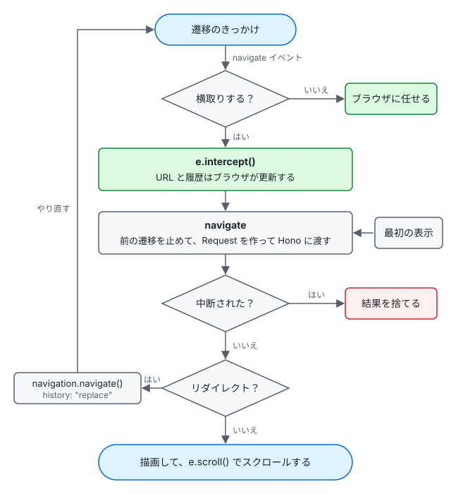

# 遷移で何が起きているか：History API から Navigation API へ

[transition.md](transition.md) と [transition-loader.md](transition-loader.md) のルーターは、History API（`pushState` / `replaceState` / `popstate`）の上で動いていた。ここでは、その土台を Navigation API に乗り換えると、遷移の流れの何が変わるかをまとめる。loader を呼ぶ、Hono に `Request` を渡す、描画に知らせる、といった真ん中のところは変わらない。

## History API で、ルーターが自分でやっていたこと

History API は「URL を書き換える」「戻る・進むが押されたと知らせる」の 2 つしかしない。ブラウザは、ページの中で遷移が起きていることを知らない。だから、遷移のまわりのことはルーターが全部自分でやっていた。

- リンクのクリックを `document` で横取りし、新しいタブで開く操作（Ctrl / Cmd クリックなど）や別のサイトへのリンクを、自分で見分ける
- フォームの送信を別のリスナーで横取りし、`new FormData(form)` で中身を取り出す
- 戻る・進むは `popstate` という別の道で受ける
- `pushState` で URL を書き換えて、履歴を積む
- 履歴の項目に自分で key を振り、項目ごとのスクロール位置を `Map` に覚えておく
- ブラウザのスクロールの自動復元を止めて（`history.scrollRestoration = "manual"`）、自分で戻す
- 遷移ごとに `AbortController` を作り、次の遷移が始まったら前の遷移を止める

入り口が「クリック」「送信」「戻る・進む」の 3 本に分かれていて、それぞれで URL の扱いが違う（クリックと送信は `pushState` する、戻る・進むはしない）。

## Navigation API とは

`window.navigation` にある、ページの中の遷移を扱う API。中心は `navigate` イベントで、ページの中で起きる遷移は、きっかけが何であっても全部ここに来る。

- リンクのクリック
- フォームの送信
- 戻る・進む
- `navigation.navigate()` / `navigation.back()` などをコードから呼んだとき

イベントには、その遷移のことが入っている。

| プロパティ | 中身 |
|---|---|
| `e.destination.url` | 行き先の URL |
| `e.navigationType` | `"push"` / `"replace"` / `"traverse"`（戻る・進む）/ `"reload"` |
| `e.canIntercept` | 横取りできるか。別オリジンへの遷移などは `false` |
| `e.hashChange` | 同じページの `#hash` への移動か |
| `e.downloadRequest` | `<a download>` によるダウンロードなら、そのファイル名。違えば `null` |
| `e.formData` | POST のフォームの送信なら、送った中身。違えば `null` |
| `e.signal` | この遷移が中断されたら abort される `AbortSignal` |
| `e.info` | `navigation.navigate(url, { info })` で渡したもの |

`e.intercept({ handler })` を呼ぶと、その遷移をページの読み込みではなく、ページの中の遷移にできる。URL の書き換えと履歴を積むことはブラウザがやり、ルーターは `handler` の中で画面を作るだけになる。`handler` が返す Promise が終わるまでを、ブラウザは「遷移中」として扱う。

History API では、ブラウザにとっての遷移は「URL が書き換わった」という一瞬の出来事だった。Navigation API では、ブラウザが遷移の始まりから終わりまでを知っている。これが一番の違い。

Chrome / Edge は 2022 年から使える。Safari 26.2（2025 年 12 月）と Firefox 147（2026 年 1 月）で入り、2026 年 1 月に Baseline Newly Available になった。

## 何が変わったか

| 手順 | History API | Navigation API |
|---|---|---|
| 遷移を受ける | `click` / `submit` / `popstate` の 3 つのリスナー | `navigate` イベント 1 つ |
| 横取りしないものを見分ける | 修飾キー、`a.origin` を自分で見る | `canIntercept` / `hashChange` / `downloadRequest`。新しいタブで開く操作では、イベント自体が来ない |
| URL を書き換える | `pushState` | ブラウザがやる |
| フォームの中身 | `new FormData(form)` | `e.formData` |
| リダイレクト | `replaceState` して、自分で `navigate` をもう一度呼ぶ | `navigation.navigate(next, { history: "replace" })` で、新しい遷移を始める |
| スクロール位置 | 項目に key を振って、自分で覚えて戻す | `e.scroll()` を呼ぶと、ブラウザが戻す |
| 前の遷移を止める | 自分の `AbortController` | `e.signal` と、自分の `AbortController` をつなぐ |
| 最初に開いたとき | 自分で `navigate` を呼ぶ | 変わらない |

---

## 1. 遷移を受ける：3 つのリスナーが 1 つに

```ts
// packages/core/src/router.ts
navigation.addEventListener("navigate", (e) => {
  if (!e.canIntercept || e.hashChange || e.downloadRequest !== null) return;
  const info = e.info as NavigateInfo | undefined;
  e.intercept({
    scroll: "manual",
    async handler() {
      const init = e.formData ? { method: "POST", body: e.formData } : undefined;
      if (!(await navigate(e.destination.url, init, info?.revalidate, e.signal))) return;
      await new Promise(requestAnimationFrame);
      if (info?.resetScroll !== false) e.scroll();
    },
  });
});
```

- リンクのクリックも、フォームの送信も、戻る・進むも、このリスナーに来る。どの場合も `e.destination.url` を `navigate` に渡せばいい
- 次のものは `return` して、ブラウザに任せる
  - 横取りできない遷移（`canIntercept` が `false`）。別オリジンへの遷移など
  - 同じページの `#hash` への移動（`hashChange`）。ブラウザがその場所までスクロールしてくれる
  - ダウンロードのリンク（`downloadRequest`）
- Ctrl / Cmd クリックなどの「新しいタブで開く」操作は、今のページの遷移ではないので、`navigate` イベント自体が来ない。History API のときのように、修飾キーを自分で見る必要がない

## 2. URL を書き換える：しなくてよくなる

History API では、クリックを横取りしたら `pushState` で URL を書き換えていた。`e.intercept()` を呼べば、URL の書き換えも、履歴を積むことも、ブラウザがやる。

- 積むか置き換えるかも、ブラウザが決める。リンクのクリックなら積む（`"push"`）、戻る・進むなら積まずに移る（`"traverse"`）
- transition.md の「戻る・進むで `pushState` すると、進む先が消える」という注意は、もう要らない。ルーターが履歴に触らないから

## 3. フォームを送信したとき：中身はイベントに入っている

```ts
const init = e.formData ? { method: "POST", body: e.formData } : undefined;
```

- POST のフォームを送信すると、`navigate` イベントの `e.formData` に送った中身が入っている。`submit` を横取りして `new FormData(form)` を作る必要がない
- `<form method="get">` を送信したときは、`e.formData` は `null` で、行き先の URL に中身が `?q=...` のように入っている。リンクのクリックと同じ GET の遷移として扱える
- `init` を `navigate` に渡すと POST の `Request` になり、Hono で action が動く。ここから先は transition-loader.md のとおり

## 4. コードから遷移するとき：navigation.navigate()

```ts
// packages/core/src/router.ts（createRouter の戻り値）
navigate(to, { replace = false, resetScroll = true } = {}) {
  const url = new URL(to, location.href).href;
  navigation.navigate(url, { history: replace ? "replace" : "push", info: { resetScroll } });
},
```

- `navigation.navigate()` を呼ぶと、リンクのクリックと同じように `navigate` イベントが来る。ルーターはここで遷移を進めず、イベントに任せる。どこから始まった遷移でも、通る道は 1 本になる
- 積むか置き換えるかは `history` で選ぶ
- `info` に入れたものは、イベントの `e.info` で受け取れる。URL に出したくない「この遷移のときだけの指定」（ここではスクロールしないこと）を渡すのに使う

## 5. リダイレクトのとき：新しい遷移を始める

```ts
// packages/core/src/router.ts（navigate の中）
const location = res.headers.get("Location");
if (res.status >= 300 && res.status < 400 && location) {
  const next = new URL(location, url).href;
  navigation.navigate(next, { history: "replace", info: { revalidate: afterAction } });
  return false;
}
```

- History API のときは、`replaceState` で URL を置き換えてから、自分で `navigate` をもう一度呼んでいた
- 今は、`history: "replace"` で新しい遷移を始めるだけ。新しい遷移も同じ `navigate` イベントを通る。行き先がまたリダイレクトなら、それも同じように処理される
- `"replace"` なので履歴は積まない。ログインしていないときに `/admin` を開くと、`/admin` の項目が `/login` に置き換わる。transition.md の「戻ってもまたリダイレクトされて、いつまでも戻れない」は起きない
- 新しい遷移が始まると、元の遷移は中断されたことになる。元の遷移は `AbortError` で終わり、`navigateerror` イベントが出る。元の遷移は、行き先への遷移に置き換わって終わったので、これで正しい

`e.intercept()` には、URL を書き換える前に待てる `precommitHandler` もある。その中なら、URL を書き換える前にリダイレクトできる（`controller.redirect()`）。ただ、Safari 26.2 はまだ対応していない。

## 6. スクロールする：ブラウザに任せる

```ts
e.intercept({
  scroll: "manual",
  async handler() {
    // ...描く
    await new Promise(requestAnimationFrame);
    e.scroll();
  },
});
```

- `e.intercept()` は、何も指定しなければ、`handler` が終わったときにブラウザがスクロールする（`scroll: "after-transition"`）
- このルーターでは、`handler` が終わっても、描画が DOM に反映されているとは限らない。だから `scroll: "manual"` で止めておき、1 フレーム待ってから `e.scroll()` を呼ぶ
- `e.scroll()` は、遷移の種類に合わせてスクロールする
  - 新しいページ（`"push"` / `"replace"`）：一番上。URL に `#hash` があれば、その要素の位置
  - 戻る・進む（`"traverse"`）：その項目を離れたときの位置

位置はブラウザが履歴の項目ごとに覚えている。履歴の項目に key を振ることも、位置を `Map` に覚えることも、`history.scrollRestoration = "manual"` も要らなくなった。ブラウザが覚えているので、ページをリロードしたあとでも、戻れば元の位置に戻る（ルーターの `Map` はリロードで消えていた）。

項目を見分けたいときは、ブラウザが振った key（`navigation.currentEntry.key`）がある。

## 7. 遷移が重なったとき：e.signal と自分の AbortController

```ts
// packages/core/src/router.ts（navigate の最初）
current?.abort();
const controller = (current = new AbortController());
const signal = eventSignal ? AbortSignal.any([controller.signal, eventSignal]) : controller.signal;
```

- `e.signal` は、その遷移が中断されたら abort される。次の遷移が始まったときや、ユーザーがブラウザの「中止」を押したとき
- ただし、abort されるのは `handler` が終わるまで。`handler` が終わったあとに次の遷移が来ても、もう abort されない
- loader を裏で取り直している途中（stale-while-revalidate）のように、`handler` が終わったあとも続く仕事がある。それを次の遷移で止めるために、ルーターは自分の `AbortController` も持ち続ける
- `AbortSignal.any([...])` は、渡した signal のどれかが abort されたら abort される signal を作る。これを `Request` に持たせるので、loader はどちらの理由で止まっても気づける

## 8. ページを最初に開いたとき：変わらない

```ts
// packages/core/src/router.ts（createRouter の最後）
navigate(location.href);
```

ページを最初に開いたときは、ブラウザがページを読み込んでいるので、`navigate` イベントは来ない。History API のときと同じく、ルーターを作ったときに自分で 1 回呼ぶ。

---

## まとめ



History API では、ルーターが「遷移のきっかけを見分ける」「URL と履歴を書き換える」「スクロール位置を覚える」を自分でやっていた。Navigation API では、それをブラウザがやる（図の緑の箱）。ルーターに残ったのは、`handler` の中で「Hono に聞いて、loader を呼んで、描く」ことだけ。
