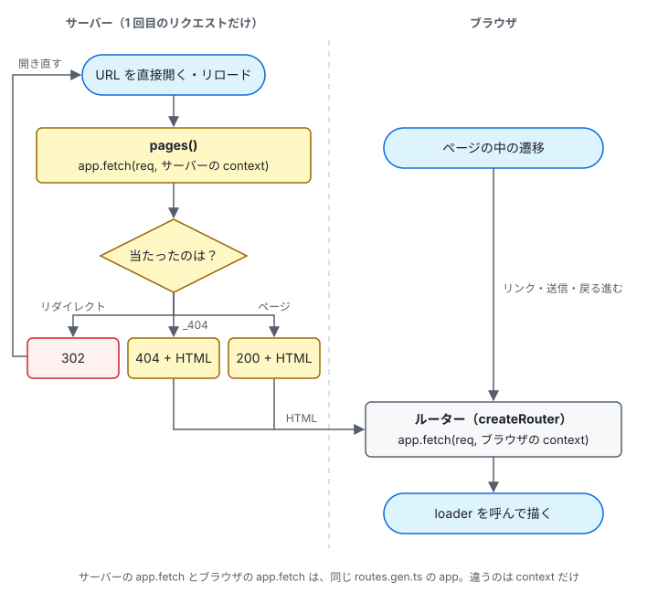

# サーバーでも同じ app を動かす

SPA のサーバーは、ふつうはルートのことを何も知らない。ここでは、ブラウザで動いているルートの表（Hono の app）をサーバーにも置いて、ページを開いたときに正しいステータスを返すようにすると、何が変わるかをまとめる。loader と画面は、今まで通りブラウザで動かす。

## HTML が送られるのは、1 回目だけ

SPA では、サーバーから HTML が送られるのは、ページを「開いた」ときだけ。そのあとの遷移では、サーバーに何も聞かない。

| 操作 | サーバーにリクエストが行く | HTML が送られる |
|---|---|---|
| URL を打って開く、ブックマークや共有されたリンクから開く | 行く | 送られる |
| リロード | 行く | 送られる |
| 新しいタブで開く | 行く | 送られる |
| ページの中でリンクを押す、戻る・進む、フォームを送信する | 行かない | 送られない |

ページの中の遷移は、`navigate` イベントで横取りして、ブラウザの中の Hono がルートを判定する（[navigation-api.md](navigation-api.md)）。サーバーが返す HTML は、空っぽの `<div id="app">` と、ルーターの JS を読み込む `<script>` だけ。描画はブラウザが `#app` の中を描き替えて行う。loader が API を呼べばデータのリクエストは飛ぶが、それは HTML ではない。

問題は、1 回目に開くのがどの URL かわからないこと。トップページとは限らず、`/users/5` を直接開くことも、`/admin` を開いたままリロードすることもある。

## ふつうの SPA では、どの URL でも 200

ふつうの SPA のサーバーは、どのルートがあるかを知らない。だから、どの URL で 1 回目のリクエストが来ても、同じ HTML を 200 で返す。無いページも、ログインが要るページも同じ。

ログインしていない人が `/admin` を直接開くと、こう進む。

1. サーバーが HTML を 200 で返す
2. ブラウザが JS を読み込んで動かす
3. ブラウザの中で、ルーターがガードを通して、ログインしていないとわかる
4. `/login` に移って描く

HTTP のステータスは、サーバーがレスポンスを返すときに 1 回だけ決まる。ブラウザが JS で 404 の画面を描いても、`/login` に移っても、最初のレスポンスのステータスは 200 のまま変わらない。

## サーバーを使う 3 つの段階

サーバーにどこまでさせるかで、段階が分かれる。

| | サーバーがすること | loader が動く場所 | loader から DB を直接触れる |
|---|---|---|---|
| A. ルートの判定だけ | ルートとガードを判定して、ステータスを決め、HTML を返す | ブラウザ | 触れない |
| B. SSR | 1 回目だけ、loader を呼んで画面を HTML にして返す | 1 回目はサーバー、そのあとはブラウザ | 触れない（ブラウザでも動くから） |
| C. サーバーの loader | 遷移のたびに loader を動かして、データを返す | いつもサーバー | 触れる |

React Router v7 に当てはめると、こうなる。

```ts
// React Router（framework mode）のルートのファイル

// サーバーで動く。DB を直接触れる（C）
export async function loader({ params }) {
  return db.user.find(params.id);
}

// ブラウザで動く。API に取りに行く
export async function clientLoader({ params }) {
  return fetch(`/api/users/${params.id}`).then((r) => r.json());
}
```

- このルーターの `loader` は、React Router の `clientLoader`（または data mode の loader）と同じで、ブラウザで動く
- C は、React Router の framework mode の `loader`（`ssr: true`）。loader は必ずサーバーで動き、ブラウザで遷移すると、ルーターがサーバーに loader の結果を取りに行く。フルスタックのフレームワークになる
- B は、TanStack Start のデフォルトの形。React Router にはない
- A は、React Router にも TanStack Router にもない。どちらも、ブラウザで loader を動かす SPA のままでは、サーバーでルートを判定できない。正しいステータスを返したければ、loader がサーバーで動く構成に移るしかない

このルーターでは A ができる。ルートの表とガードが、もともと Hono の app だから。Hono はサーバーのフレームワークなので、同じ app をそのままサーバーに置ける。

## 同じ app で判定する

```ts
// packages/core/src/server.ts
export function pages(app: Hono, options: PagesOptions): Handler {
  return async (c) => {
    const req = new Request(c.req.url, { headers: c.req.raw.headers });
    const res = await app.fetch(req, options.context?.(c));

    const location = res.headers.get("Location");
    if (res.status >= 300 && res.status < 400 && location) return c.redirect(location, res.status);

    const match = matchOf(req);
    const status = match ? (match.route.notFound ? 404 : 200) : res.status;
    return c.html(options.html, status);
  };
}
```

- ブラウザのルーターと同じく、`Request` を作って `app.fetch` に渡す。Hono がルートを探し、`_middleware.ts` を通す
- loader も画面も動かさない。見るのは、`app.fetch` が返した `Response` と、当たったルートだけ

| `app.fetch` の結果 | サーバーが返すもの |
|---|---|
| ページに当たった | HTML を 200 で |
| `_404.tsx` に当たった、どのルートにも当たらなかった | HTML を 404 で |
| middleware がリダイレクトした | そのリダイレクト。HTML は返さない |
| middleware がほかのステータス（403 など）を返した | HTML をそのステータスで |

`_404.tsx` は `"*"` で登録しているので、Hono から見ると「当たった」になる。だから、生成する `routes.gen.ts` で、このルートに `notFound: true` の印を付けている。

アプリの側では、普通の Hono のサーバーに `pages()` をつなぐ。

```ts
// apps/hono-jsx/src/server.ts
const server = new Hono();
// server.route("/api", api) のように、API も同じ Hono に置ける
server.get("*", pages(app, { html, context: (c) => createContext(/* リクエストの cookie を読み書きする */) }));
export default server;
```

ページを開いたときの判定と API を、1 つの Hono のサーバーに置ける。ガードも普通の Hono の middleware なので、`hono/cookie` などの Hono の仕組みがそのまま使える。

## context は、形が同じで中身が違う

loader / action / middleware に渡す `context` は、サーバーとブラウザで別のものを作る。

```ts
// apps/hono-jsx/src/context.ts
export const createContext = (cookie: CookieJar) => ({ users, session: createSession(cookie) });

declare module "@hcr/core" {
  interface Register {
    context: ReturnType<typeof createContext>;
  }
}
```

```ts
// ブラウザ（main.tsx）：document.cookie を読み書きする。ルーターを作るときに 1 回だけ作る
createContext({ get: () => /* document.cookie から読む */, set: (value) => /* document.cookie に書く */ });

// サーバー（server.ts）：リクエストの Cookie ヘッダーを読み書きする。リクエストごとに作る
createContext({ get: () => getCookie(c, "session"), set: (value) => setCookie(c, "session", value) });
```

- サーバーには、ブラウザのメモリにあるものが見えない。サーバーとブラウザが同じ判定をするには、判定に使うもの（ここではログイン状態）を、両方から見える場所に置く必要がある。リクエストと一緒にサーバーに届く cookie がそれにあたる
- サーバーは、たくさんの人のリクエストを受ける。ログイン状態は人によって違うので、`context` はリクエストごとに作る。ブラウザは 1 人ぶんなので、1 回作れば足りる
- 同じ `createContext` から作るので、形がずれると型エラーになる。`_middleware.ts` は、どちらで動いているかを知らずに `c.env.session.user()` を呼べる

`app.fetch(req, context)` の第 2 引数は、Hono では `c.env` になる。Cloudflare Workers で env（バインディング）を渡すのと同じ通り道なので、サーバーを Workers に置けば、D1 などのバインディングもここから渡せる。

サンプルの cookie には「ログインしているか」しか入れていない。本物では、書き換えられないように署名付きの cookie（`hono/cookie` の `setSignedCookie`）にする。

## サーバーのガードは、守りにはならない

サーバーが `/admin` の HTML を返さなくても、データは守れていない。

- ブラウザの JS（`client.js`）には、`/admin` の画面のコードも入っている
- データは、ブラウザで動く loader が API から取ってくる

データを守るのは、loader が呼ぶ API の側。サーバーのガードは、ステータスを正しくすることと、入れない人に、入れない画面をそもそも見せないためのもの。

## dev とビルド

**dev**

```ts
// apps/hono-jsx/vite.config.ts（dev のとき）
plugins: [routes(), devServer({ entry: "src/server.ts" })]
```

- `@hono/vite-dev-server` が、Vite の dev サーバーの中で `src/server.ts` を動かす。ページを開いたときのリクエストは Hono が受け、`.tsx` などのファイルは Vite が返す
- Hono が返した HTML には、Vite の HMR のスクリプトが自動で足される

**ビルド**は 2 回に分かれる。

```bash
vite build --mode client   # src/main.tsx  → dist/static/client.js（ブラウザの分）
vite build                 # src/server.ts → dist/index.js（Node で動くサーバー。@hono/vite-build/node）
```

- ブラウザの分は、入口を `src/main.tsx` に直接向ける。`index.html` は要らない
- サーバーの分は、`/static/*` のファイルも返す
- HTML が読み込むスクリプトは、dev では Vite が返す `/src/main.tsx`、ビルドしたあとは `/static/client.js`。`import.meta.env.PROD` で切り替える
- ビルドの前に `dist/` を消す。古いビルドのファイルが残っていると、静的ファイルとして返されてしまう
- Cloudflare Workers に置くなら、`@hono/vite-build/node` を `@hono/vite-build/cloudflare-workers` に替える

ふつうの SPA の `index.html` には、2 つの役目があった。どの URL でも返す HTML と、ビルドの入口。前者は `server.ts` が、後者は `src/main.tsx` が受け持つようになった。

## 何がよくなるか

**1. 直接開いたときに、行き先がすぐ決まる**

ログインしていない人が `/admin` を直接開くと、サーバーがすぐに 302 を返し、ブラウザは `/login` を開き直す。JS を読み込んで動かすまで行き先がわからない、ということがなくなる。

**2. 人ではないものに、正しく伝わる**

ステータスを見るのは、人より機械。

- 検索エンジン：200 で「見つかりません」と描かれたページは、Google では「ソフト 404」として扱われる。無いページが検索結果に残ったり、サイトの評価に響いたりする
- リンクのプレビュー：Slack や X に URL を貼ると、サーバーがそのページを取りに来る。取りに来るプログラムは JS を動かさないので、ステータスしか判断材料がない
- サーバーのログや監視：切れたリンクへのアクセスが、404 としてログに残る
- CDN：200 と 404 では、キャッシュのしかたが違う

**3. SSR の足場になる**

サーバーが、URL がどのルートに当たり、どのガードを通るかをもう知っている。あとは、そのルートの loader を呼んで画面を HTML にすれば SSR になる。

効き目はアプリによって違う。検索から人が来る公開サイトでは 2 が大きい。ログインして使う管理画面では、効くのは 1 とログくらい。

## SPA の待ち時間のうち、何が減るか

| 待ち時間 | A（ルートの判定） | なくすには |
|---|---|---|
| 入れないページを直接開いたとき、JS が動いてからリダイレクトされる | なくなる | — |
| 無いページを直接開いたとき、JS が動いてから 404 の画面が出る | ステータスは最初から 404。画面はまだ JS が描く | SSR |
| どのページでも、直接開いたとき、JS を読み込むまで真っ白で、そのあと loader のデータを待つ | 残る | SSR |
| ページの中の遷移 | もともとない（前の画面のまま待つか、Pending を出す） | — |

A がなくすのは、「行き先を決めるまでの待ち」。「中身を描くまでの待ち」は残り、それをなくすのが SSR。

---

## まとめ



サーバーが受けるのは、URL を直接開いたときとリロードしたときの 1 回目のリクエストだけ。そこでブラウザと同じ app でルートを判定し、ステータスを決めて HTML を返す。そのあとの遷移は、今まで通りブラウザの中の app が判定する。サーバーとブラウザで違うのは、`app.fetch` に渡す context だけ。
