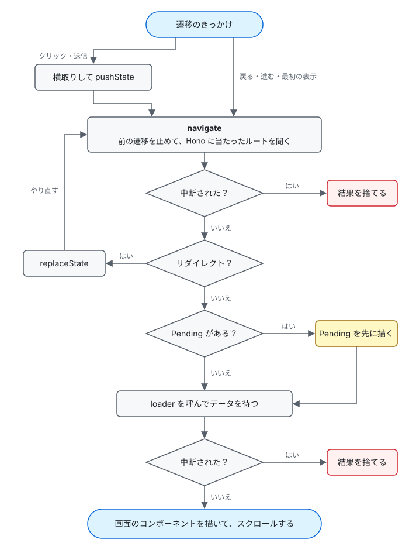

# 遷移で何が起きているか：transition.md のあとに変わったところ

[transition.md](transition.md) を書いたあとに、遷移の流れで変わったところだけをまとめる。クリックの横取り、リダイレクトの基本、中断の基本のように変わっていないところは、transition.md のとおり。

## 何が変わったか

| 手順 | transition.md の時点 | 今 |
|---|---|---|
| URL を書き換える | `pushState(null, ...)` | 履歴の項目に key を付けて、離れるときのスクロール位置を覚える |
| 遷移の始まり | 何も知らせない | 「遷移中」を先に知らせる |
| Hono がすること | ハンドラがデータを取って、描いた view を置く | 当たったルートと params を置くだけ |
| データを取る | Hono のハンドラ（`GET`） | ルーターが `loader` を呼ぶ |
| 待っている間 | 前の画面のまま | `Pending` があれば、新しいレイアウトの中に先に描く |
| レイアウトで包む | Hono の middleware | 描画（adapter） |
| 描いたあと | 何もしない | スクロールする |
| フォーム送信 | `POST` のハンドラ | `action` |
| 中断を確かめる場所 | `app.fetch` のあとの 1 か所 | `app.fetch` のあとと、loader のあとの 2 か所 |

---

## 1. URL を書き換える：履歴の項目に key を付ける

```ts
// src/router.ts
function push(url: string) {
  positions.set(currentKey, scrollY);
  currentKey = newKey();
  history.pushState({ key: currentKey }, "", url);
}
```

- transition.md の時点では `pushState` の第 1 引数は `null` だった。今は `{ key }` を入れて、履歴の項目の目印にしている
- 積む前に、今の項目のスクロール位置を `positions` に覚えておく。戻ってきたときに、この位置に戻す（「戻る・進むを押したとき」で使う）

## 2. 遷移中であることを先に知らせる

```ts
// src/router.ts（navigate の最初）
current?.abort();
const controller = (current = new AbortController());
const { signal } = controller;

if (!state.navigating) publish({ navigating: true });
```

- 前の遷移を止めたあとに、描画に「遷移中」とだけ知らせる。画面はまだ前のまま
- 描画側では `useNavigating()` で読める。全体のレイアウトの「読み込み中…」はこれを見ている

```tsx
// src/routes/_layout.tsx
const navigating = useNavigating();
// ...
{navigating && <span> 読み込み中…</span>}
```

## 3. Hono が返すもの：描いた view から、当たったルートへ

transition.md の時点では、Hono のハンドラがデータを取って `c.render()` で描き、その view を `WeakMap` に置いていた。今は、どのルートに当たったかだけを置く。

```ts
// src/routes.gen.ts（plugins/routes.ts が書き出す）
function page(app: Hono, path: string, route: Route, middlewares: MiddlewareHandler[]) {
  if (route.Component) {
    app.on("GET", [path], ...middlewares, (c) => {
      putMatch(c.req.raw, route, c.req.param() as Record<string, string>);
      return c.body(null);
    });
  }
  // POST は「フォームを送信したとき」で説明
}

page(app, "/users/:id", toRoute(page7, [Layout1, Layout8]), []);
page(app, "/admin", toRoute(page4, [Layout1]), [middleware3]);
```

```ts
// src/router.ts
const matches = new WeakMap<Request, Match>();

export function putMatch(req: Request, route: Route, params: Record<string, string>) {
  matches.set(req, { route, params });
}
```

- ルートは `src/routes/` のディレクトリから生成される。そのルートに当たるディレクトリの `_middleware.ts` が、ハンドラの前に並ぶ
- GET のハンドラは、データを取らないし、描画もしない。当たったルートと params を置いて、空の `Response` を返すだけ
- `Request` をキーにした `WeakMap` で受け渡すのは、transition.md のときと同じ。置くものが view から当たったルートに変わった

ルーターは `app.fetch` のあと、リダイレクトでなければ、同じ `Request` で当たったルートを取り出す。

```ts
// src/router.ts（navigate の続き）
const match = matches.get(req);
const { route, params } = match;
```

## 4. Pending があれば、先に描く

```ts
// src/router.ts（navigate の続き）
if (route.Pending) publish({ match, status: "pending", data: undefined, error: undefined });
```

```tsx
// src/routes/users/[id]/index.tsx
export function Pending() {
  return <p>ユーザーを読み込み中…</p>;
}
```

- ページのファイルが `Pending` を export していれば、データを待たずに、新しいルートを `status: "pending"` で知らせる
- 描画はそれを受けて、新しいレイアウトの中に `Pending` を描く。/about から /users/1 に移ると、サイドバーがすぐに出て、中身が「ユーザーを読み込み中…」になる
- `Pending` がなければ、何も知らせない。前の画面のまま、手順 2 の「遷移中」だけが続く

これができるのは、手順 3 で、データを待つ前に当たったルートを受け取っているから。transition.md の時点では、Hono のハンドラが終わるまで、ルーターには何を出すのかがわからなかった。

## 5. loader を呼ぶのはルーター

```ts
// src/router.ts（navigate の続き）
try {
  const data = await route.loader?.({ params, request: req });
  if (signal.aborted) return;
  publish({ match, status: "success", data, error: undefined, navigating: false });
} catch (error) {
  if (signal.aborted) return;
  publish({ match, status: "error", data: undefined, error, navigating: false });
}
```

```tsx
// src/routes/users/[id]/index.tsx
export const loader = ({ params, request }: LoaderArgs<"/users/:id">) =>
  fetchUser(params.id, request.signal);
```

- transition.md の時点では、データは Hono のハンドラの中で `c.req.raw.signal` を使って取っていた。今は、ルーターが loader を呼ぶ
- loader には `{ params, request }` を渡す。`request` は Hono に渡したのと同じもので、`request.signal` で中断に気づける
- loader がないルート（/about など）は、`route.loader?.(...)` が `undefined` になって、すぐ次に進む
- 届いたら `status: "success"`、失敗したら `status: "error"` で知らせる

## 6. 描画：レイアウトで包むのが adapter の仕事に

```tsx
// src/jsx-adapter.tsx
function View({ state }: { state: RouterState }) {
  if (!state.match) return null;
  const { route } = state.match;
  const Pending = route.Pending as FC | undefined;
  const Component = route.Component as FC<{ data: unknown }> | undefined;

  let content: Child = null;
  if (state.status === "pending" && Pending) content = <Pending />;
  else if (state.status === "error") content = <p>エラーが発生しました：{String(state.error)}</p>;
  else if (state.status === "success" && Component) content = <Component data={state.data} />;

  return (route.layouts as Layout[]).reduceRight<Child>((children, Layout) => <Layout>{children}</Layout>, content);
}
```

```tsx
// src/routes/users/[id]/index.tsx
export default function UserPage({ data }: { data: Awaited<ReturnType<typeof loader>> }) {
  return <h1>{data.name}</h1>;
}
```

- transition.md の時点では、描画は受け取った view をそのまま出すだけだった。今は、状態を見て `Pending` / 画面のコンポーネント / エラーのどれかを選ぶ
- 画面のコンポーネント（ページのファイルの default export）には、loader の結果を `data` として渡す
- レイアウトで包むのも、Hono の middleware ではなく描画の仕事になった。`reduceRight` で内側から包むので、外側のディレクトリのレイアウトほど外に来る

## 7. スクロールする

```ts
// src/router.ts（navigate の最後）
requestAnimationFrame(() => scrollTo(0, scrollTop));
```

- 新しいページなら一番上（`scrollTop` の初期値は 0）、戻る・進むなら覚えておいた位置に移る
- 描画が DOM に反映されるのを待つために、`requestAnimationFrame` で 1 フレーム待ってからスクロールする

---

## フォームを送信したとき：POST のハンドラから action へ

```ts
// src/routes.gen.ts（page の続き）
const action = route.action;
if (action) {
  app.on("POST", [path], ...middlewares, (c) =>
    action({ params: c.req.param() as Record<string, string>, request: c.req.raw }),
  );
}
```

```tsx
// src/routes/login/index.tsx
export const action = () => {
  logIn();
  return redirect(href("/admin"));
};
```

- ページのファイルは、`POST` の代わりに `action` を export する。受け取るものは loader と同じ `{ params, request }`
- GET と違って、action は Hono のハンドラの中で動く。action が返す `Response`（たいていリダイレクト）を、そのままルーターに返すため
- action がリダイレクトしなかったときは、同じ URL を GET で読み直す

---

## 戻る・進むを押したとき：スクロール位置を戻す

```ts
// src/router.ts
window.addEventListener("popstate", (e) => {
  positions.set(currentKey, scrollY);
  currentKey = e.state?.key ?? newKey();
  navigate(location.href, undefined, positions.get(currentKey) ?? 0);
});
```

- `popstate` の時点で、URL はもう変わっているが、スクロールはまだ前の項目のまま。だから、ここで前の項目の位置を覚えられる
- `e.state.key` で、戻ってきた項目がわかる。その項目を離れたときの位置を `navigate` に渡すので、手順 7 で元の位置に戻る

スクロール位置を戻すのはブラウザではなくルーター。`history.scrollRestoration = "manual"` でブラウザの自動復元を止めている。ブラウザは `popstate` の直後に位置を戻そうとするが、その時点ではまだ新しい画面を描いていないので、位置がずれるため。

---

## 遷移が重なったとき：確かめる場所が 2 か所に

```ts
// src/router.ts
const res = await app.fetch(req);
if (signal.aborted) return; // 1 か所目

const data = await route.loader?.({ params, request: req });
if (signal.aborted) return; // 2 か所目
```

- transition.md の時点では、データの取得も `app.fetch` の中だったので、確かめるのは `app.fetch` のあとの 1 か所でよかった
- 今は loader を `app.fetch` の外で呼ぶので、loader のあとでも確かめる。どちらも `await` で待つところなので、待っている間に次の遷移が始まりうる
- loader が中断で失敗したときも、`catch` の中で同じように確かめて、エラーとして知らせない

---

## まとめ



transition.md の図から増えたのは、「Pending がある？」の分岐と、loader のあとの「中断された？」。
