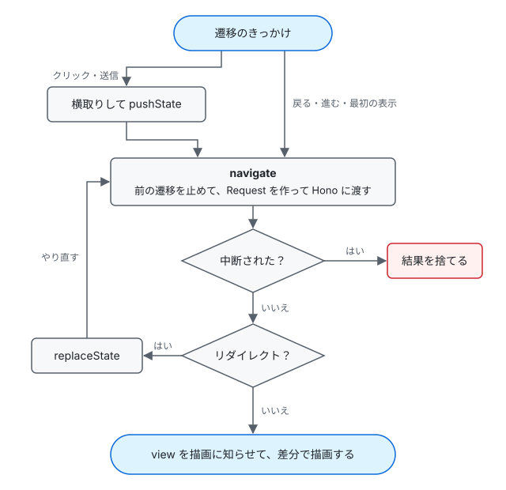

# 遷移で何が起きているか

リンクをクリックしてから画面が変わるまでに、何がどの順で起きているかを、コードと一緒に一項目ずつまとめる。

## 登場するもの

| 担当 | 場所 | 仕事 |
|---|---|---|
| ブラウザ | — | URL と履歴を持っている。戻る・進むが押されると `popstate` イベントを出す |
| ルーター | `src/router.ts` | 遷移を最初から最後まで進める |
| Hono | `src/routes.tsx` | どの URL で何をするかを決める（マッチング、ガード、loader、action） |
| 描画 | `src/jsx-adapter.tsx` | 出すもの（view）を画面に描く |

ルーターは「どの URL で何をするか」を知らない。それを決めるのは Hono で、ルーターは Hono に聞いて、返ってきた答えを描画に渡す。

---

## リンクをクリックしたとき

### 1. クリックを横取りする

```ts
// src/router.ts
document.addEventListener("click", (e) => {
  // 新しいタブで開く操作（Ctrl/Cmd クリックなど）はブラウザに任せる
  if (e.button !== 0 || e.metaKey || e.ctrlKey || e.shiftKey || e.altKey) return;

  const a = (e.target as Element).closest("a");
  if (!a || a.origin !== location.origin) return;

  e.preventDefault();
  // ...
});
```

- `document` に 1 つだけリスナーを付けている。リンクごとに付けなくても、クリックはイベントの伝わり（バブリング）で `document` まで届く
- `closest("a")` で、クリックされた要素を含む `<a>` を探す。`<a>` の中の `<span>` をクリックしても、`<a>` が見つかる
- `e.preventDefault()` で、ブラウザがページを読み込み直すのを止める。これがないと、サーバーにページを取りに行ってしまう
- 次の 2 つは横取りしない。ブラウザに任せる
  - 左クリック以外や、Ctrl / Cmd などを押しながらのクリック（新しいタブで開く操作）
  - 別のサイトへのリンク（`a.origin` が今のページと違う）

### 2. URL を書き換える

```ts
// src/router.ts（クリックのリスナーの続き）
history.pushState(null, "", a.href);
navigate(a.href);
```

- `history.pushState` で URL を変え、履歴を 1 つ積む。ページは読み込み直されない
- `pushState` は URL を変えるだけで、画面には何もしない。画面を変えるのは、このあと呼ぶ `navigate` の仕事

### 3. Request を作る

```ts
// src/router.ts
async function navigate(url: string, init?: RequestInit) {
  // 新しい遷移が始まったら、古い遷移は止める
  current?.abort();
  const controller = (current = new AbortController());
  const { signal } = controller;

  const req = new Request(url, { ...init, signal });
  // ...
}
```

- 新しい URL から `Request` を作る。サーバーに送るときと同じ、Web 標準の `Request`
- 遷移ごとに `AbortController` を作り、その `signal` を `Request` に持たせる。あとで遷移を中断するために使う（「遷移が重なったとき」で説明）
- `init` はフォーム送信のときに使う。クリックのときは何も渡さないので、GET になる

### 4. Hono に渡す

```ts
// src/router.ts（navigate の続き）
const res = await app.fetch(req);
```

ルーターがするのは `app.fetch` を呼ぶことだけ。ここから先は Hono の中で進む。

**4-1. マッチするルートを探して、middleware を通る**

```tsx
// src/routes.tsx
app.use("*", jsxRenderer());
app.use("/users/*", layout(UsersLayout));
```

- Hono が URL を見て、当てはまる middleware とハンドラを順に呼ぶ
- `/users/1` なら、`jsxRenderer()` → `layout(UsersLayout)` → `/users/:id` のハンドラの順に通る

**4-2. ハンドラがデータを取る（loader）**

```tsx
// src/routes.tsx
app.get("/users/:id", async (c) => {
  const user = await fetchUser(c.req.param("id"), c.req.raw.signal);
  return c.render(
    <>
      <h1>{user.name}</h1>
      <p>ID: {user.id}</p>
    </>,
  );
});
```

- `c.req.param("id")` で、URL の `:id` の部分を受け取る
- ハンドラを `async` にして `await` すれば、それが loader になる。データが届くまで、遷移はここで待つ
- `c.req.raw.signal` は、手順 3 でルーターが `Request` に持たせた `signal`

**4-3. 出すものを置いて、空の Response を返す**

```tsx
// src/jsx-adapter.tsx
function show(c: Context, view: Child) {
  putView(c.req.raw, view);
  return c.body(null);
}

export function layout(Layout: FC<{ children?: Child }>): MiddlewareHandler {
  return async (c, next) => {
    c.setRenderer((content) => show(c, <Layout>{content}</Layout>));
    await next();
  };
}
```

```ts
// src/router.ts
const views = new WeakMap<Request, unknown>();

export function putView(req: Request, view: unknown) {
  views.set(req, view);
}
```

- ハンドラが呼ぶ `c.render(...)` の中身は、middleware が `c.setRenderer` で決めている
- `layout()` を通ったルートでは、ハンドラが渡した画面が `<Layout>` で包まれる
- `Response` の本文には JSX を入れられない。だから JSX は `Request` をキーにした `WeakMap` に置き、本文が空の `Response` を返す
- `WeakMap` にしているのは、遷移が終わって `Request` が要らなくなれば、置いた JSX も一緒に消えるから

### 5. 結果を確かめる

```ts
// src/router.ts（navigate の続き）
if (signal.aborted) return; // 待っている間に古くなったら知らせない

const location = res.headers.get("Location");
if (res.status >= 300 && res.status < 400 && location) {
  // リダイレクト（後述）
}
```

Response が返ってきたら、次の 2 つを確かめる。

- 待っている間に新しい遷移が始まって、この遷移が中断されていないか。中断されていたら、結果は捨てる（「遷移が重なったとき」で説明）
- リダイレクトではないか。リダイレクトなら、別の URL でやり直す（「リダイレクトのとき」で説明）

### 6. 描画に知らせる

```ts
// src/router.ts（navigate の続き）
publish((views.get(req) as View | undefined) ?? null);

function publish(view: View | null) {
  latest = { view };
  for (const listener of listeners) listener(view);
}
```

- 手順 4-3 で置いた view を、同じ `Request` をキーにして取り出す
- `subscribe` している描画に渡す。ルーターは、受け取った側がどう描くかを知らない
- `latest` に最新の view を取っておく。あとから `subscribe` した描画にも、すぐに渡せるようにするため

```ts
// src/router.ts（createRouter の戻り値）
subscribe(listener) {
  listeners.add(listener);
  if (latest) listener(latest.view);
  return () => listeners.delete(listener);
},
```

### 7. 描画する

```tsx
// src/jsx-adapter.tsx
export function mountRouter(router: Router<Child>, root: HTMLElement) {
  let setView: (view: Child) => void = () => {};
  function App() {
    const [view, set] = useState<Child>(null);
    setView = set;
    return <>{view}</>;
  }
  render(<App />, root);

  router.subscribe((view) => setView(view));
}
```

- `App` は最初に 1 回だけマウントする。遷移のたびにマウントし直すと、画面がまるごと作り直される
- view を受け取ったら、`App` の state を更新する。hono/jsx/dom が前の画面と比べて、変わったところだけを書き換える
- `/users/1` から `/users/2` に移ると、変わるのは `<UsersLayout>` の中身だけ。サイドバーはそのまま残るので、入力欄に打った文字も消えない

---

## フォームを送信したとき

```ts
// src/router.ts
document.addEventListener("submit", (e) => {
  const form = e.target as HTMLFormElement;
  if (form.method !== "post" || new URL(form.action).origin !== location.origin) return;

  e.preventDefault();
  history.pushState(null, "", form.action);
  navigate(form.action, { method: "POST", body: new FormData(form) });
});
```

```tsx
// src/routes.tsx
app.post("/login", (c) => {
  loggedIn = true;
  return c.redirect("/admin");
});
```

流れはクリックのときと同じ。違いは次の 3 つ。

- 横取りするのは `submit` イベント。`method="post"` のフォームだけを扱う
- `navigate` に `{ method: "POST", body: new FormData(form) }` を渡すので、POST の `Request` になる
- Hono で動くのは `app.post(...)` のハンドラ。これが action にあたる

action は処理のあとにリダイレクトを返すことが多い。ログインのフォームを送ると、`pushState` で積んだ `/login` は、リダイレクトの `replaceState` で `/admin` に置き換わる。

---

## 戻る・進むを押したとき

```ts
// src/router.ts
window.addEventListener("popstate", () => navigate(location.href));
```

- 戻る・進むを押すと、ブラウザが自分で URL を変えて `popstate` イベントを出す
- ルーターは手順 1 と 2 を飛ばして、`navigate` から始める
- ここで `pushState` はしない。URL はブラウザがもう変えているし、その URL は履歴にもある。`pushState` すると履歴が 1 つ余計に積まれ、「進む」で行ける先が消えてしまう

---

## ページを最初に開いたとき

```ts
// src/router.ts（createRouter の最後）
navigate(location.href);
```

- クリックも `popstate` もないので、ルーターを作ったときに、今の URL で 1 回だけ `navigate` を呼ぶ

---

## リダイレクトのとき

```ts
// src/router.ts（navigate の中）
const location = res.headers.get("Location");
if (res.status >= 300 && res.status < 400 && location) {
  const next = new URL(location, url).href;
  history.replaceState(null, "", next);
  return navigate(next);
}
```

```tsx
// src/routes.tsx
app.use("/admin/*", async (c, next) => {
  if (!loggedIn) return c.redirect("/login");
  await next();
});
```

- `c.redirect("/login")` は、ステータスが 3xx で、`Location` ヘッダーに行き先が入った Response を返す
- ルーターはそれを見て、`history.replaceState` で URL を行き先に置き換える。履歴は積まない
- そのあと、行き先の URL で `navigate` をもう一度呼ぶ。行き先がまたリダイレクトなら、それも同じように処理する
- `new URL(location, url)` は、`/login` のような相対パスを、完全な URL に直している
- ガードは middleware なので、`await next()` を呼ばずに return すると、その先のハンドラは動かない

ここで `pushState` を使うと、ログインしていない状態で `/admin` を開いたとき、履歴は「`/admin` → `/login`」になる。戻るボタンで `/admin` に戻ると、またリダイレクトされて `/login` に来る。いつまでも戻れない。

---

## 遷移が重なったとき

手順 4-2 でデータを待っている間に、次のリンクがクリックされることがある。何もしないと、遅れて届いた古い結果で画面が上書きされ、URL と画面が食い違う。

**前の遷移を止める**

```ts
// src/router.ts（navigate の最初）
current?.abort();
const controller = (current = new AbortController());
```

- `current` は、いま進行中の遷移の `AbortController`
- 新しい遷移が始まったら、前の遷移を `abort()` してから、新しい controller に入れ替える

**ハンドラ側：データの取得を止める**

```tsx
// src/routes.tsx
function fetchUser(id: string, signal: AbortSignal) {
  return new Promise<{ id: string; name: string }>((resolve, reject) => {
    const timer = setTimeout(() => resolve({ id, name: `ユーザー${id}` }), Math.random() * 2000);
    signal.addEventListener("abort", () => {
      clearTimeout(timer);
      reject(signal.reason);
    });
  });
}
```

- `abort()` されると、`signal` の `abort` イベントが起きる。ここで取得を止めて、Promise を失敗させている
- 本物の `fetch(url, { signal })` なら、これを `fetch` が自動でやってくれる

**ルーター側：結果を捨てる**

```ts
// src/router.ts（手順 5）
if (signal.aborted) return;
```

- `app.fetch` から戻ってきたら、この遷移が中断されていないかを確かめる。中断されていたら、描画に知らせずに終わる
- ハンドラが `signal` を使っていなくても、ここで捨てるので、画面が食い違うことはない

---

## まとめ



ルーターがするのは、この流れを回すことだけ。何を出すかは Hono が決めて、どう描くかは描画が決める。
